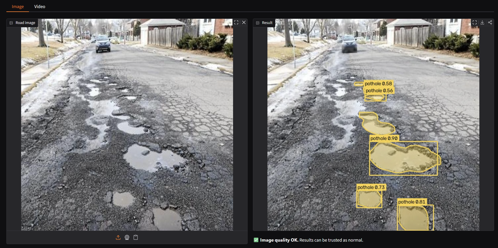
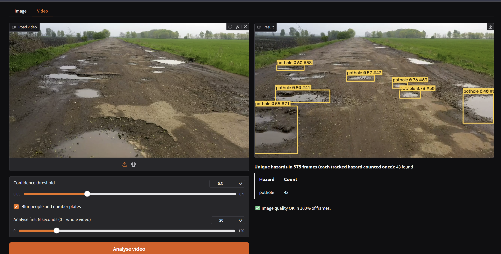
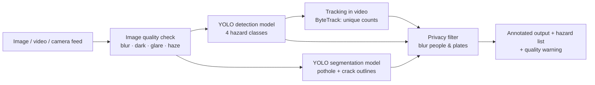
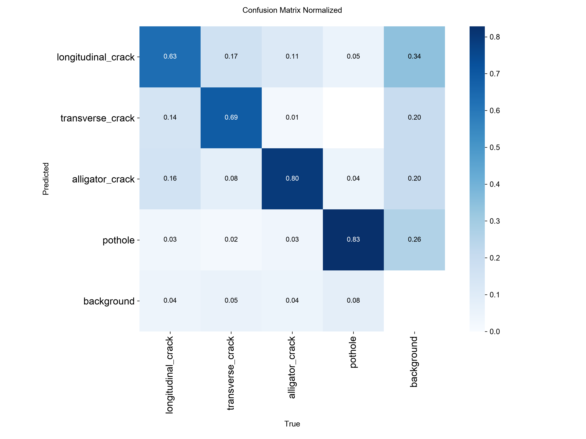
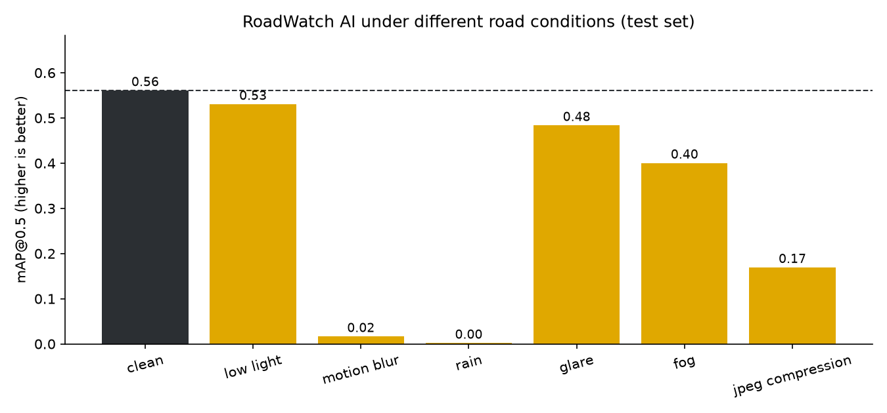
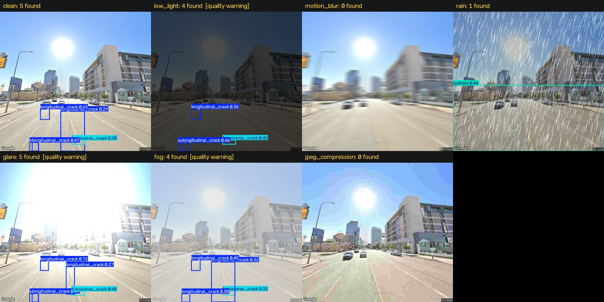

# 🛣️ RoadWatch AI: Road Surface and Hazard Detection

**Team HerAlzon** · Ang Vning (Group Leader) · Kong Jing Han
*AI Women Hackathon · Challenge 14: RoadWatch AI*

RoadWatch AI is a computer-vision system that detects **road surface damage** in images and video:
**potholes, longitudinal cracks, transverse cracks and alligator cracks**. Every detection comes with a
hazard type, a location (bounding box, plus a pixel outline for potholes) and a confidence score.

It is built to run on road-inspection robots, drones or vehicle cameras, turning road maintenance from
**reactive** (waiting for public complaints) into **proactive** (finding damage before it causes harm).

> ⚠️ RoadWatch AI is a decision-support prototype. Its detections are **not official infrastructure safety
> assessments** and should be verified by qualified road inspectors.

## 🎬 Demo

**▶️ Demo video:** [Watch on YouTube / Google Drive](https://drive.google.com/drive/folders/1xOgz_md-vEJ1JVoqYXWpHIdOK24Y_RNy?usp=drive_link): data collection → training → testing → live app demo




---

## ✨ What makes it different

| | Feature | Why it matters |
|---|---|---|
| 🌧 | **Stress-tested in bad conditions** | Accuracy measured under low light, motion blur, rain, glare, fog and heavy compression, showing where it works *and* where it struggles |
| 🛑 | **Knows when it can't see clearly** | An image-quality check flags blurry, dark, glare or hazy images as *unreliable* instead of silently guessing |
| 🌏 | **Not limited to one country** | Trained on RDD2022 road images from several countries, and tested on a country never seen in training |
| 🎭 | **Tested against look-alikes** | False-alarm test on puddles, shadows, manholes and cones (things that look like damage but aren't) |
| 🎥 | **Counts each hazard once in video** | Object tracking (ByteTrack) gives each pothole an ID, so a video reports unique hazards rather than one box per frame |
| 🔒 | **Privacy built in** | People and vehicle number-plate areas are blurred automatically in all outputs |

---

## 🏗️ Architecture



| Component | Implementation |
|---|---|
| Detection | Ultralytics **YOLOv8s** (single-stage CNN), COCO-pretrained, fine-tuned on road damage |
| Segmentation | **YOLOv8n-seg** for pixel-level outlines of **potholes and cracks** |
| Post-processing | Non-maximum suppression, confidence threshold |
| Quality check | Laplacian variance (sharpness), mean brightness, near-white ratio (glare), contrast (`roadwatch/quality.py`) |
| Video tracking | ByteTrack; a hazard counts once when tracked for ≥ 3 frames |
| Privacy | COCO YOLOv8n finds people and vehicles; people and the plate area of vehicles are blurred (`roadwatch/privacy.py`) |
| Demo | Gradio web app (image + video tabs) |

---

## 🧠 Models

| | Detection model | Segmentation model |
|---|---|---|
| File | `weights/roadwatch_det.pt` (22.5 MB) | `weights/roadwatch_seg.pt` (7.0 MB) |
| Architecture | YOLOv8s (11.1 M parameters) | YOLOv8n-seg (3.4 M parameters) |
| Classes | longitudinal crack, transverse crack, alligator crack, pothole | pothole, crack |
| Starting point | COCO-pretrained `yolov8s.pt` (transfer learning) | COCO-pretrained `yolov8n-seg.pt` |
| Training data | 7,550 images (RDD2022 + Roboflow + negatives) | 1,490 images (Roboflow + CRACK500) |
| Training | 85 epochs (early stop, best at epoch 70), 2.3 h | 40 epochs, 12 min |
| Settings | image size 640, batch 16, AdamW (auto), cosine LR, mosaic, HSV/rotation/scale/flip augmentation | image size 640, batch 16 |
| Hardware | NVIDIA RTX 5050 Laptop GPU (8 GB) | same |
| Speed | about 6 ms per image | about 2.5 ms per image |
| Test result | mAP@0.5 **0.562** (4 classes) | mask mAP@0.5 **0.764** (pothole), 0.352 (crack) |

A COCO-pretrained YOLOv8n (`yolov8n.pt`, downloaded automatically) is used only for the privacy filter (people and vehicles).
An earlier pothole-only model from a previous project of ours was used as a baseline reference only; all models above were trained during the hackathon.

## 📊 Datasets

| Dataset | Content | Labels | License |
|---|---|---|---|
| [RDD2022](https://github.com/sekilab/RoadDamageDetector) (Japan, India, United States, Czech) | Street-level road images | Boxes: D00, D10, D20, D40 | CC BY-SA 4.0 |
| [Pothole Segmentation YOLOv8](https://universe.roboflow.com/farzad/pothole_segmentation_yolov8) (Roboflow) | Pothole photos | Polygons | CC BY 4.0 |
| [CRACK500](https://github.com/fyangneil/pavement-crack-detection) ([Kaggle copy](https://www.kaggle.com/datasets/pauldavid22/crack50020220509t090436z001)) | Close-up pavement crack photos | Pixel masks → converted to crack outlines | Research use |
| [Road_Condition/Alert](https://www.kaggle.com/datasets/saadkhan0/road-conditionalert-dataset) (Kaggle) | Road photos sorted into folders (potholes, clean, smooth, …) | Image-level (folder) labels | Apache 2.0 |

**How each dataset is used**
- **Detection model (4 classes):** RDD2022 (D00 → longitudinal crack · D10 → transverse crack · D20 → alligator crack · D40 → pothole) + Roboflow potholes (polygons → boxes) + damage-free roads from Road_Condition/Alert (`clean_roads`, `smooth_roads`) as extra negatives
- **Segmentation model (2 classes):** Roboflow pothole polygons + CRACK500 crack masks (converted automatically to outlines; CRACK500 has no crack-type labels, so cracks form one "crack" class)
- **Independent image-level test:** unused Road_Condition/Alert images (pothole folder vs clean/smooth folders): no box labels needed

**Data preparation (`scripts/prepare_data.py`)**
- RDD2022 Pascal VOC XML converted to YOLO format; Roboflow polygons converted to pothole boxes
- **Negative images** (roads with no damage) kept so the model learns what normal road looks like
- **80 / 10 / 10 train / val / test split.** Augmented copies of the same Roboflow photo are always kept in the same split, to prevent test-set leakage
- **Held-out country:** Czech images are never used in training and serve as an *unseen-country* test
- Training augmentation: brightness/saturation, rotation, translation, scale, flips, mosaic

| Split | Images | Boxes (long. / trans. / alligator / pothole) | Notes |
|---|---|---|---|
| Train | 7,550 | 4,828 / 2,403 / 3,220 / 4,256 | includes damage-free negatives |
| Validation | 942 | 594 / 264 / 398 / 573 | used for model selection |
| Test | 938 | 631 / 325 / 402 / 472 | **never used in training or tuning** |
| Unseen country (Czech) | 1,232 | 988 / 399 / 161 / 197 | **country never seen in training** |
| Segmentation train / val / test | 1,490 / 253 / 537 | pothole + crack outlines | Roboflow + CRACK500 |

---

## 📈 Results

> All numbers come from `scripts/evaluate.py`, `scripts/robustness.py`, `scripts/error_analysis.py` and
> `scripts/image_level_test.py`, on data the models never saw during training.
> Detection model: YOLOv8s, 85 epochs (early-stopped, best at epoch 70), RTX 5050 Laptop GPU, about 6 ms per image.

### ⭐ Key findings
- **Test-set mAP@0.5 = 0.562** across 4 hazard types, matching validation (0.574), so the model is not overfitting.
- **Independent dataset:** finds a pothole in **81%** of unseen pothole photos with only **1%** false alarms on clean roads.
- **Segmentation outlines potholes better than boxes do:** box mAP@0.5 0.776 vs 0.740 on identical images.
- **Robust to low light (−5%) and glare (−14%)**, but **heavy motion blur and rain break the model**, and the quality check does not yet catch them reliably (see Robustness).
- **Big drop on an unseen country** (Czech: 0.157 vs 0.562), which shows road-damage AI needs **local training data** before deployment (e.g. Malaysian roads).

### Test set: per-class detection performance
| Class | Precision | Recall | F1 | mAP@0.5 | mAP@0.5:0.95 |
|---|---|---|---|---|---|
| Longitudinal crack | 0.620 | 0.566 | 0.591 | 0.598 | 0.315 |
| Transverse crack | 0.604 | 0.465 | 0.526 | 0.510 | 0.215 |
| Alligator crack | 0.636 | 0.590 | 0.612 | 0.606 | 0.300 |
| Pothole | 0.610 | 0.496 | 0.547 | 0.535 | 0.253 |
| **All** | **0.617** | **0.529** | **0.570** | **0.562** | **0.271** |



### Unseen country (Czech, never in training)
| Class | Precision | Recall | F1 | mAP@0.5 |
|---|---|---|---|---|
| Longitudinal crack | 0.485 | 0.234 | 0.315 | 0.254 |
| Transverse crack | 0.276 | 0.301 | 0.288 | 0.171 |
| Alligator crack | 0.126 | 0.429 | 0.195 | 0.139 |
| Pothole | 0.157 | 0.112 | 0.131 | 0.064 |
| **All** | **0.261** | **0.269** | **0.265** | **0.157** |

Performance drops sharply on a country absent from training (different road surfaces, camera setup and
annotation style). Cracks transfer better than potholes. **Takeaway:** a few hundred labelled local images
are needed before deploying in a new country; this is our first next step for Malaysia.

### Detection vs segmentation (identical 72 pothole test images)
| Model | Precision | Recall | F1 | mAP@0.5 | mAP@0.5:0.95 |
|---|---|---|---|---|---|
| Detection (box) | 0.692 | 0.712 | 0.702 | 0.740 | 0.413 |
| Segmentation (box) | 0.709 | 0.740 | 0.724 | **0.776** | **0.474** |
| Segmentation (mask) | 0.673 | 0.726 | 0.699 | 0.764 | 0.421 |

The segmentation model (3.4 M parameters) localises potholes slightly better than the detector (11.1 M), and
also gives the exact damaged area. The detector remains necessary for the three crack types.

### Segmentation: pixel outlines per class (test set)
| Class | Mask precision | Mask recall | Mask F1 | Mask mAP@0.5 |
|---|---|---|---|---|
| Pothole | 0.675 | 0.726 | 0.700 | 0.764 |
| Crack | 0.544 | 0.382 | 0.448 | 0.352 |

Thin cracks are much harder to outline than potholes: many fine crack pixels are missed (recall 0.38).
The crack score is lower on test (0.35) than validation (0.61) because the CRACK500 test crops contain more
hairline cracks.

### Independent image-level test (Road_Condition/Alert, never used in training)
| Group | Images | Result | Rate |
|---|---|---|---|
| Pothole images | 300 | 244 had a pothole detected | **81%** |
| Clean / smooth roads | 251 | 3 had a false alarm | **1%** |

### Robustness under different conditions (400 test images, severe synthetic conditions)
| Condition | Precision | Recall | mAP@0.5 | Change vs clean | Flagged by quality check |
|---|---|---|---|---|---|
| Clean | 0.604 | 0.511 | 0.561 | – | 5% |
| Low light | 0.583 | 0.508 | 0.530 | **−5%** | 100% |
| Glare | 0.536 | 0.480 | 0.483 | −14% | 96% |
| Fog | 0.468 | 0.410 | 0.400 | −29% | 79% |
| JPEG compression | 0.380 | 0.185 | 0.169 | −70% | 8% |
| Motion blur | 0.441 | 0.028 | 0.016 | **−97%** | 52% |
| Rain | 0.053 | 0.018 | 0.002 | **−100%** | 24% |




**What this shows**
- **Lighting changes are handled well:** low light costs only 5% and glare 14%, thanks to brightness augmentation in training.
- **Fine detail is the weak point:** motion blur, heavy rain streaks and strong compression destroy the thin crack edges the model relies on.
- **The quality check catches lighting problems (79–100%) but misses many blur, rain and compression cases (8–52%).**
  Its thresholds were calibrated on close-up pothole photos and need recalibrating on street-level footage (next step).
- These synthetic conditions are deliberately **severe** (e.g. 25-pixel motion blur, about 1,000 rain streaks); real dashcam footage is usually milder.

---

## 🔍 Error analysis

From `scripts/error_analysis.py` (test set, confidence ≥ 0.25). Galleries: `results/errors_false_alarms.jpg`, `results/errors_misses.jpg`.

| Class | Correct | False alarms | Missed | Wrong class |
|---|---|---|---|---|
| Longitudinal crack | 381 | 338 | 240 | 10 |
| Transverse crack | 170 | 143 | 154 | 1 |
| Alligator crack | 247 | 186 | 142 | 13 |
| Pothole | 243 | 222 | 227 | 2 |

- **Wrong-class confusions are rare (26 in total):** when the model finds damage, it usually names the type correctly. Most are alligator ↔ longitudinal cracks, where cracks branch into each other.
- **Transverse cracks are missed most often** (154 missed vs 170 found): they are thin, short and the rarest class in training.
- **False alarms and misses are roughly balanced** at the default confidence (0.25). Raising the threshold reduces false alarms at the cost of more misses; this can be tuned per use case.
**Main causes (from reviewing the most confident errors)**

| Error type | Cause | Example |
|---|---|---|
| "False alarm" | **Real but unlabelled cracks.** Many high-confidence "false" crack detections show genuine thin cracks the RDD2022 annotators did not box, so true precision is likely **higher** than reported | Clear longitudinal cracks next to lane markings scored as false |
| False alarm | **Tree shadows and lane markings:** long thin dark shadows look like longitudinal cracks | Shadow stripes across the road → "longitudinal crack 0.84" |
| False alarm | **Dark stains, wet patches and repairs** look like potholes | Dark patch / blurred dark spot → "pothole 0.80" |
| False alarm | **Rough road texture** mistaken for alligator cracking | Coarse worn asphalt → "alligator crack" |
| Wrong class | **Branching cracks** sit between longitudinal and alligator | Crack networks labelled longitudinal, predicted alligator |
| Missed | **Annotation granularity:** one huge box around a whole damaged area, while the model predicts several smaller potholes, so the large box counts as missed | Close-up photos of many merged potholes |
| Missed | **Faint, distant, low-contrast damage** in dashcam frames (India), barely visible even to humans | Fine alligator cracking far ahead of the car hood |
| Missed | **Water-filled potholes** look like puddles or reflections | Flooded pothole with sky reflection |
| Robustness | **Fine detail destroyed:** blur and compression erase crack edges (0 found); **rain streaks are mistaken for damage** (one large false "pothole") | `results/robustness_examples.jpg` |

**Improvements suggested by these errors:** re-check labels on the most confident "false alarms"; add shadow, wet-road and repaired-patch images as hard negatives; label potholes individually rather than as large areas; add blur, rain and compression augmentation in training; and recalibrate the quality check on street-level footage.

---

## ⚠️ Limitations

- **Not a measurement tool:** a single 2D image has no depth or scale, so RoadWatch AI does not measure pothole depth or real size. Severity estimation needs a calibrated, fixed-mount camera (future work).
- **Data coverage / new countries:** training images come from Japan, India and the US; on Czech roads (never seen) mAP@0.5 fell from 0.562 to 0.157. No Malaysian road images yet; local data is needed before deployment.
- **Class imbalance:** transverse cracks have the fewest examples and the lowest accuracy (mAP@0.5 0.51).
- **Fine-detail conditions:** heavy motion blur, rain and strong compression almost completely break detection (see Robustness).
- **Thin cracks in segmentation** are often only partly outlined (crack mask recall 0.38).
- **Synthetic stress tests:** rain, fog and glare are simulated; real-weather footage may behave differently.
- **Quality-check thresholds** are hand-calibrated heuristics: they catch lighting problems well but miss many blurred, rainy or heavily compressed images (8–52% flagged), and flag about 5% of clean images.
- **Privacy filter** relies on a general-purpose detector and may miss small, distant or partly hidden people and plates.
- **Some training photos** in public datasets are stock or web-scraped images (some with watermarks); these may bias the model, and the Road_Condition/Alert set contains augmented near-duplicates.
- **CRACK500 cracks are close-up, top-down views** and have no crack-type labels, so the segmentation model outlines "crack" without telling crack types apart (the detection model does that).

## 🤝 Responsible AI

- **Permitted data only:** publicly licensed datasets (CC BY / CC BY-SA), credited above
- **Privacy by design:** people and number plates are blurred in every output
- **Honest about uncertainty:** every detection has a confidence score, and poor images get a warning
- **Human in the loop:** outputs are decision support for inspectors, not automatic repair orders or official assessments
- **Transparent evaluation:** test sets never used in training; failures reported, not just successes

---

## 🚀 Quick start

```bash
# 1. Install (Python 3.10+). For GPU, install PyTorch with CUDA first: https://pytorch.org/get-started/locally/
pip install -r requirements.txt

# 2. Run the demo (needs weights/roadwatch_det.pt; weights/roadwatch_seg.pt optional)
python app.py            # http://127.0.0.1:7860
python app.py --share    # temporary public link
```

### Reproduce training and evaluation

```bash
python scripts/download_rdd.py --countries Japan India United_States Czech --out data/RDD2022
python scripts/prepare_data.py --rdd-root data/RDD2022 --countries Japan India United_States Czech \
       --holdout Czech --pothole-root data/pothole_dataset --crack500-root data/CRACK500 \
       --extra-negatives data/RoadAlert/clean_roads data/RoadAlert/smooth_roads --max-per-country 2500
python scripts/train_detect.py --model yolov8s.pt --epochs 60 --hours 2.5
python scripts/train_segment.py --model yolov8n-seg.pt --epochs 60
python scripts/evaluate.py
python scripts/robustness.py --max-images 400
python scripts/error_analysis.py --lookalike-dir data/lookalikes   # look-alike folder optional
python scripts/image_level_test.py --pothole-dir data/RoadAlert/potholes \
       --clean-dirs data/RoadAlert/clean_roads data/RoadAlert/smooth_roads
```

## 📁 Repository structure

```
roadwatch-ai/
├── app.py                    # Gradio demo (image + video)
├── roadwatch/
│   ├── detector.py           # pipeline: quality → detect → segment → track → privacy
│   ├── quality.py            # image quality check
│   ├── privacy.py            # blur people and number plates
│   └── perturb.py            # synthetic conditions for robustness tests
├── scripts/
│   ├── download_rdd.py       # download RDD2022 country subsets
│   ├── prepare_data.py       # convert, merge, split datasets
│   ├── train_detect.py       # train 4-class detector
│   ├── train_segment.py      # train pothole segmentation model
│   ├── evaluate.py           # per-class metrics, unseen country, detection vs segmentation
│   ├── robustness.py         # stress test under bad conditions
│   ├── error_analysis.py     # false alarms, misses, look-alike test
│   └── image_level_test.py   # independent folder-labelled test (pothole vs clean roads)
├── configs/                  # dataset YAMLs (generated)
├── weights/                  # trained models
├── results/                  # metrics, charts, error galleries
└── assets/examples/          # example images for the demo
```

## 🔭 Future work

- **Deploy** on road-inspection robots and drones
- **Map it:** GPS-tag every detection on a live map
- **Predict damage-prone roads** from repeat scans (how often damage reappears on each road)
- **Connect** to government road cameras and public reporting apps (e.g. MyJalan)
- **Expand** with Malaysian road images
- **Go deeper:** depth cameras for rutting, sinking and true severity

## 🙏 Acknowledgements

- RDD2022: Arya, D. et al., *RDD2022: A multi-national image dataset for automatic road damage detection* (2022)
- Roboflow Universe pothole segmentation dataset (user "farzad"), CC BY 4.0
- CRACK500: Yang, F. et al., *Feature Pyramid and Hierarchical Boosting Network for Pavement Crack Detection*, IEEE T-ITS (2019)
- Road_Condition/Alert dataset (Kaggle user Saad Khan), Apache 2.0
- [Ultralytics YOLO](https://github.com/ultralytics/ultralytics), [Gradio](https://gradio.app)

## 📜 License

AGPL-3.0, matching [Ultralytics YOLO](https://github.com/ultralytics/ultralytics). Datasets keep their own licenses (see Datasets).
