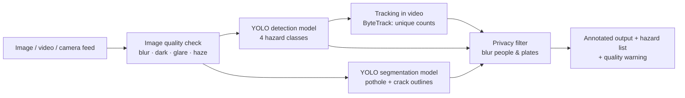

# 🛣️ RoadWatch AI: Road Surface and Hazard Detection

**Team HerAlzon** · Ang Vning (Group Leader) · Kong Jing Han
*AI Women Hackathon · Challenge 14: RoadWatch AI*

RoadWatch AI is a computer-vision system that detects **road surface damage** in images and video:
**potholes, longitudinal cracks, transverse cracks and alligator cracks**. Every detection comes with a
hazard type, a location (bounding box, plus a pixel outline for potholes) and a confidence score.

It is built to run on road-inspection robots, drones or vehicle cameras, turning road maintenance from
**reactive** (waiting for public complaints) into **proactive** (finding damage before it causes harm).

> ⚠️ RoadWatch AI is a decision-support prototype. Its detections are **not official infrastructure safety
> assessments** and should be verified by qualified road inspectors.

---

## ✨ What makes it different

| | Feature | Why it matters |
|---|---|---|
| 🌧 | **Stress-tested in bad conditions** | Accuracy measured under low light, motion blur, rain, glare, fog and heavy compression, showing where it works *and* where it struggles |
| 🛑 | **Knows when it can't see clearly** | An image-quality check flags blurry, dark, glare or hazy images as *unreliable* instead of silently guessing |
| 🌏 | **Not limited to one country** | Trained on RDD2022 road images from several countries, and tested on a country never seen in training |
| 🎭 | **Tested against look-alikes** | False-alarm test on puddles, shadows, manholes and cones (things that look like damage but aren't) |
| 🎥 | **Counts each hazard once in video** | Object tracking (ByteTrack) gives each pothole an ID, so a video reports unique hazards rather than one box per frame |
| 🔒 | **Privacy built in** | People and vehicle number-plate areas are blurred automatically in all outputs |

---

## 🏗️ Architecture



| Component | Implementation |
|---|---|
| Detection | Ultralytics **YOLOv8s** (single-stage CNN), COCO-pretrained, fine-tuned on road damage |
| Segmentation | **YOLOv8n-seg** for pixel-level outlines of **potholes and cracks** |
| Post-processing | Non-maximum suppression, confidence threshold |
| Quality check | Laplacian variance (sharpness), mean brightness, near-white ratio (glare), contrast (`roadwatch/quality.py`) |
| Video tracking | ByteTrack; a hazard counts once when tracked for ≥ 3 frames |
| Privacy | COCO YOLOv8n finds people and vehicles; people and the plate area of vehicles are blurred (`roadwatch/privacy.py`) |
| Demo | Gradio web app (image + video tabs) |

---

## 📊 Datasets

| Dataset | Content | Labels | License |
|---|---|---|---|
| [RDD2022](https://github.com/sekilab/RoadDamageDetector) (Japan, India, United States, Czech) | Street-level road images | Boxes: D00, D10, D20, D40 | CC BY-SA 4.0 |
| [Pothole Segmentation YOLOv8](https://universe.roboflow.com/farzad/pothole_segmentation_yolov8) (Roboflow) | Pothole photos | Polygons | CC BY 4.0 |
| [CRACK500](https://github.com/fyangneil/pavement-crack-detection) ([Kaggle copy](https://www.kaggle.com/datasets/pauldavid22/crack50020220509t090436z001)) | Close-up pavement crack photos | Pixel masks → converted to crack outlines | Research use |
| [Road_Condition/Alert](https://www.kaggle.com/datasets/saadkhan0/road-conditionalert-dataset) (Kaggle) | Road photos sorted into folders (potholes, clean, smooth, …) | Image-level (folder) labels | Apache 2.0 |

**How each dataset is used**
- **Detection model (4 classes):** RDD2022 (D00 → longitudinal crack · D10 → transverse crack · D20 → alligator crack · D40 → pothole) + Roboflow potholes (polygons → boxes) + damage-free roads from Road_Condition/Alert (`clean_roads`, `smooth_roads`) as extra negatives
- **Segmentation model (2 classes):** Roboflow pothole polygons + CRACK500 crack masks (converted automatically to outlines; CRACK500 has no crack-type labels, so cracks form one "crack" class)
- **Independent image-level test:** unused Road_Condition/Alert images (pothole folder vs clean/smooth folders): no box labels needed

**Data preparation (`scripts/prepare_data.py`)**
- RDD2022 Pascal VOC XML converted to YOLO format; Roboflow polygons converted to pothole boxes
- **Negative images** (roads with no damage) kept so the model learns what normal road looks like
- **80 / 10 / 10 train / val / test split.** Augmented copies of the same Roboflow photo are always kept in the same split, to prevent test-set leakage
- **Held-out country:** Czech images are never used in training and serve as an *unseen-country* test
- Training augmentation: brightness/saturation, rotation, translation, scale, flips, mosaic

<!-- Paste results/dataset_summary.json numbers here -->
| Split | Images | Notes |
|---|---|---|
| Train | _fill in_ | |
| Validation | _fill in_ | |
| Test | _fill in_ | never used in training or tuning |
| Unseen country (Czech) | _fill in_ | never used in training |

---

## 📈 Results

> All numbers below come from `scripts/evaluate.py`, `scripts/robustness.py` and `scripts/error_analysis.py`
> on data the model never saw during training. Replace the placeholders with `results/summary.md`.

### Test set: per-class performance
| Class | Precision | Recall | F1 | mAP@0.5 | mAP@0.5:0.95 |
|---|---|---|---|---|---|
| Longitudinal crack | | | | | |
| Transverse crack | | | | | |
| Alligator crack | | | | | |
| Pothole | | | | | |
| **All** | | | | | |

### Unseen country (Czech)
| | Precision | Recall | F1 | mAP@0.5 |
|---|---|---|---|---|
| All classes | | | | |

### Detection vs segmentation (same pothole test images)
| Model | Precision | Recall | mAP@0.5 | mAP@0.5:0.95 |
|---|---|---|---|---|
| Detection (box) | | | | |
| Segmentation (box) | | | | |
| Segmentation (mask) | | | | |

### Segmentation: pixel outlines per class (test set)
| Class | Mask precision | Mask recall | Mask F1 | Mask mAP@0.5 |
|---|---|---|---|---|
| Pothole | | | | |
| Crack | | | | |

### Independent image-level test (Road_Condition/Alert, never used in training)
| Group | Images | Result | Rate |
|---|---|---|---|
| Pothole images | | pothole detected | |
| Clean / smooth roads | | false alarm | |

### Robustness under different conditions
| Condition | mAP@0.5 | Change vs clean | Flagged by quality check |
|---|---|---|---|
| Clean | | – | |
| Low light | | | |
| Motion blur | | | |
| Rain | | | |
| Glare | | | |
| Fog | | | |
| JPEG compression | | | |


### Confusion matrix


---

## 🔍 Error analysis

From `scripts/error_analysis.py` (see `results/errors_false_alarms.jpg`, `results/errors_misses.jpg`):

| Class | Correct | False alarms | Missed | Wrong class |
|---|---|---|---|---|
| _fill in from results/error_analysis.md_ | | | | |

**Main causes of errors** *(fill in after looking at the galleries)*
- False alarms: e.g. shadows, wet patches, road markings, repair patches, traffic cones
- Misses: e.g. small or distant hazards, low contrast, partly hidden damage
- Confusions: e.g. alligator vs longitudinal cracks at crack junctions

---

## ⚠️ Limitations

- **Not a measurement tool:** a single 2D image has no depth or scale, so RoadWatch AI does not measure pothole depth or real size. Severity estimation needs a calibrated, fixed-mount camera (future work).
- **Data coverage:** training images come mainly from Japan, India and the US; no Malaysian road images yet. Performance may drop on very different roads, lighting or camera types.
- **Class imbalance:** some crack types have far fewer examples than potholes, which lowers their accuracy.
- **Synthetic stress tests:** rain, fog and glare are simulated; real-weather footage may behave differently.
- **Quality-check thresholds** are hand-calibrated heuristics; about 9% of clean images in calibration were flagged, and some degraded images are missed.
- **Privacy filter** relies on a general-purpose detector and may miss small, distant or partly hidden people and plates.
- **Some training photos** in public datasets are stock or web-scraped images (some with watermarks); these may bias the model, and the Road_Condition/Alert set contains augmented near-duplicates.
- **CRACK500 cracks are close-up, top-down views** and have no crack-type labels, so the segmentation model outlines "crack" without telling crack types apart (the detection model does that).

## 🤝 Responsible AI

- **Permitted data only:** publicly licensed datasets (CC BY / CC BY-SA), credited above
- **Privacy by design:** people and number plates are blurred in every output
- **Honest about uncertainty:** every detection has a confidence score, and poor images get a warning
- **Human in the loop:** outputs are decision support for inspectors, not automatic repair orders or official assessments
- **Transparent evaluation:** test sets never used in training; failures reported, not just successes

---

## 🚀 Quick start

```bash
# 1. Install (Python 3.10+). For GPU, install PyTorch with CUDA first: https://pytorch.org/get-started/locally/
pip install -r requirements.txt

# 2. Run the demo (needs weights/roadwatch_det.pt; weights/roadwatch_seg.pt optional)
python app.py            # http://127.0.0.1:7860
python app.py --share    # temporary public link
```

### Reproduce training and evaluation

```bash
python scripts/download_rdd.py --countries Japan India United_States Czech --out data/RDD2022
python scripts/prepare_data.py --rdd-root data/RDD2022 --countries Japan India United_States Czech \
       --holdout Czech --pothole-root data/pothole_dataset --crack500-root data/CRACK500 \
       --extra-negatives data/RoadAlert/clean_roads data/RoadAlert/smooth_roads --max-per-country 2500
python scripts/train_detect.py --model yolov8s.pt --epochs 60 --hours 2.5
python scripts/train_segment.py --model yolov8n-seg.pt --epochs 60
python scripts/evaluate.py
python scripts/robustness.py --max-images 400
python scripts/error_analysis.py --lookalike-dir data/lookalikes   # look-alike folder optional
python scripts/image_level_test.py --pothole-dir data/RoadAlert/potholes \
       --clean-dirs data/RoadAlert/clean_roads data/RoadAlert/smooth_roads
```

## 📁 Repository structure

```
roadwatch-ai/
├── app.py                    # Gradio demo (image + video)
├── roadwatch/
│   ├── detector.py           # pipeline: quality → detect → segment → track → privacy
│   ├── quality.py            # image quality check
│   ├── privacy.py            # blur people and number plates
│   └── perturb.py            # synthetic conditions for robustness tests
├── scripts/
│   ├── download_rdd.py       # download RDD2022 country subsets
│   ├── prepare_data.py       # convert, merge, split datasets
│   ├── train_detect.py       # train 4-class detector
│   ├── train_segment.py      # train pothole segmentation model
│   ├── evaluate.py           # per-class metrics, unseen country, detection vs segmentation
│   ├── robustness.py         # stress test under bad conditions
│   ├── error_analysis.py     # false alarms, misses, look-alike test
│   └── image_level_test.py   # independent folder-labelled test (pothole vs clean roads)
├── configs/                  # dataset YAMLs (generated)
├── weights/                  # trained models
├── results/                  # metrics, charts, error galleries
└── assets/examples/          # example images for the demo
```

## 🔭 Future work

- **Deploy** on road-inspection robots and drones
- **Map it:** GPS-tag every detection on a live map
- **Predict damage-prone roads** from repeat scans (how often damage reappears on each road)
- **Connect** to government road cameras and public reporting apps (e.g. MyJalan)
- **Expand** with Malaysian road images
- **Go deeper:** depth cameras for rutting, sinking and true severity

## 🙏 Acknowledgements

- RDD2022: Arya, D. et al., *RDD2022: A multi-national image dataset for automatic road damage detection* (2022)
- Roboflow Universe pothole segmentation dataset (user "farzad"), CC BY 4.0
- CRACK500: Yang, F. et al., *Feature Pyramid and Hierarchical Boosting Network for Pavement Crack Detection*, IEEE T-ITS (2019)
- Road_Condition/Alert dataset (Kaggle user Saad Khan), Apache 2.0
- [Ultralytics YOLO](https://github.com/ultralytics/ultralytics), [Gradio](https://gradio.app)

## 📜 License

AGPL-3.0, matching [Ultralytics YOLO](https://github.com/ultralytics/ultralytics). Datasets keep their own licenses (see Datasets).
